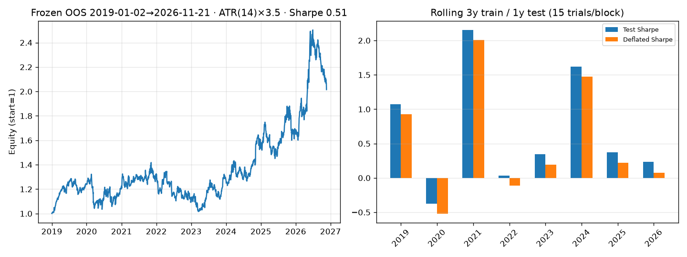

# LOOP Donchian + VWAP — corrected research

**Headline window:** 2023-01-03 → 2026-11-21 · **PIT / long history:** from 2010-01-04

## Why +54% sits next to +14%–+121% weekday range

The reported **headline** (+54.4%) is the **mean of five daily return series**, one per rebalance weekday (Mon–Fri), hold-until-stop, ATR×3. Single-weekday totals on the same calendar window run from **+14.0% to +120.8%** ({"dow_0": 20.5, "dow_1": 53.8, "dow_2": 14.0, "dow_3": 120.8, "dow_4": 69.2}). We report the average because rebalance weekday alone can move full-period totals by an order of magnitude; the dispersion table is mandatory context, not a contradiction.

## Walk-forward (15 ATR grid trials each selection)

**Frozen:** train 2010-01-04–2018-12-31, frozen test 2019-01-02→2026-11-21. Chosen **ATR(14)×3.5** (hold_until_stop). Test return **+91.3%**, Sharpe **0.51**, **deflated Sharpe 0.46** (n_trials=15).

**Rolling 3y train / 1y test:**

- 2019: return +14.3%, Sharpe 1.07, deflated 0.92, ATR(14)×3.5 (15 trials)
- 2020: return -8.8%, Sharpe -0.37, deflated -0.52, ATR(20)×4.0 (15 trials)
- 2021: return +50.4%, Sharpe 2.15, deflated 2.01, ATR(10)×4.0 (15 trials)
- 2022: return -1.0%, Sharpe 0.04, deflated -0.11, ATR(10)×4.0 (15 trials)
- 2023: return +4.1%, Sharpe 0.34, deflated 0.20, ATR(10)×4.0 (15 trials)
- 2024: return +37.3%, Sharpe 1.62, deflated 1.48, ATR(10)×4.0 (15 trials)
- 2025: return +6.1%, Sharpe 0.37, deflated 0.22, ATR(10)×4.0 (15 trials)
- 2026: return +2.4%, Sharpe 0.23, deflated 0.08, ATR(10)×4.0 (15 trials)

## Headline table (2023-01-03 → 2026-11-21)

| Series | Total return | Sharpe | Max DD |
|--------|-------------|--------|--------|
| Corrected avg weekday, hold-until-stop, ATR×3 | +54.4% | 0.77 | -21.5% |
| Legacy broken accounting | +132.9% | 1.07 | -19.4% |
| SPY | +89.9% | 1.17 | -18.8% |

## Survivorship (2010 → 2026-11-21)

| Universe | Total return | Sharpe | Max DD |
|----------|-------------|--------|--------|
| Live S&P500 ∪ Nasdaq-100 | +355.0% | 0.71 | -21.5% |
| PIT S&P 500 only (fja05680/sp500 GitHub daily membership from 1996) | +53.0% | 0.26 | -29.3% |

**Delta (live − PIT):** +302.1% return, +0.45 Sharpe.

## Charts

## Conclusion

Corrected accounting removes bogus +300% headlines. Deflated OOS Sharpes and cost stress weaken the case vs SPY/QQQ; survivorship and weekday choice remain dominant effects.
