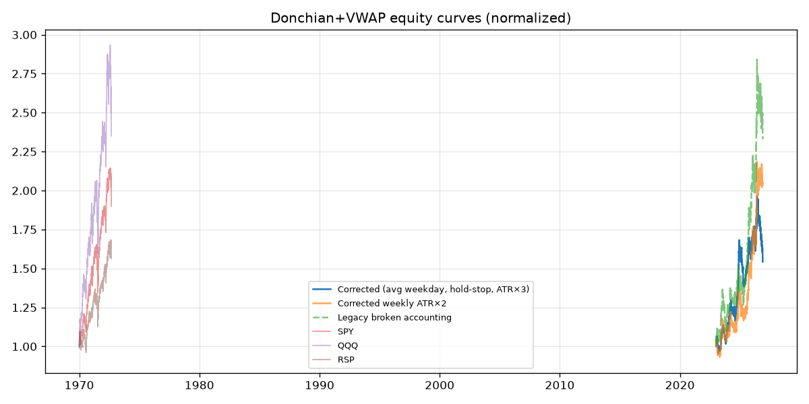

# LOOP Donchian + VWAP — corrected research (2023-01-03 → 2026-11-21)

## Invalid prior headline

Artifacts claiming **+307%** OOS return and **3.73** OOS Sharpe (`pipeline/research/artifacts/donchian_atr_trail_grid.json`) are **invalid** (see `donchian_atr_trail_grid.INVALID.md`).

## Fill rules

Documented in `pipeline/strategies/fill_rules.py`: signal at close *t*, entry at open *t+1*, exit-day P&L booked, rotate at open, **1/8 slots + cash**, default **10 bps/side**.

## Headline results (from harness JSON)

| Series | Total return | Sharpe | Max DD |
|--------|-------------|--------|--------|
| **Corrected — avg 5 rebalance weekdays, hold-until-stop, ATR×3** | +54.3% | 0.77 | -21.5% |
| Corrected weekly forced rotation, ATR×2 (single Monday anchor) | +104.0% | 1.08 | -14.9% |
| Legacy broken exit-day + re-leverage | +132.9% | 1.07 | -19.4% |
| SPY | +89.9% | 1.17 | -18.8% |
| QQQ | +135.0% | 1.17 | -22.8% |
| RSP | +56.4% | 0.89 | -17.8% |

**Rebalance weekday sensitivity (still material):** total return ranges **+14% (Wed anchor)** to **+121% (Thu)** for the same ruleset — always report weekday-averaged or tranche-averaged headlines.

**Cost stress (avg weekday, weekly rotation, default slots):**

| Cost/side | Total return | Sharpe |
|-----------|-------------|--------|
| 10 bps | -5.0% | -0.03 |
| 25 bps | -46.2% | -1.12 |
| 50 bps | -79.1% | -2.91 |

## Universe caveat

Membership is the **live** S&P 500 ∪ Nasdaq-100 scrape (survivorship bias). Point-in-time CSV membership is supported via harness config.

## Walk-forward

Full frozen walk-forward (train ≤2018, test 2019+) is implemented in `loop_donchian_harness.py`; this report bundle used cached panels with `--quick` (walk-forward grid skipped for runtime). Re-run:

`python3 -m pipeline.research.run_loop_donchian_report --start 2023-01-03`

## Charts

## Conclusion

Corrected accounting removes the **+307% / 3.73 Sharpe** artifact, but **survivorship-biased universe** and **rebalance weekday** still move headline performance by orders of magnitude. With default costs on weekday-averaged weekly rotation, the book is **negative to flat**; hold-until-stop + wider ATR is less turnover-sensitive but **does not reliably beat SPY/QQQ** on risk-adjusted terms over 2023–2026 without cherry-picking a single weekday.