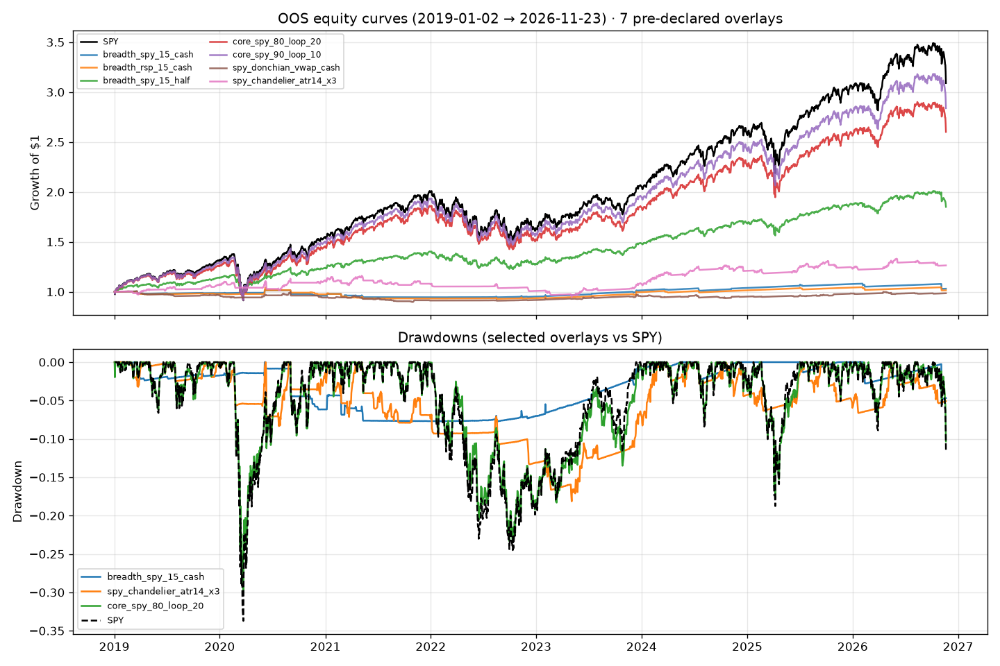

# LOOP as index overlay — research report

**Question:** Does LOOP add value as a **filter/overlay on an index** rather than as a standalone stock picker?

**Design:** 7 variants fixed **before** inspecting 2019+ outcomes (deflated Sharpe uses n_trials=7). Train context 2010–2018; **frozen OOS** 2019-01-02→2026-11-23. PIT S&P 500 membership for LOOP breadth sleeve; cash leg **BIL**; 10 bps/side on index regime turns (25 bps stress on sample variants).

## Pre-declared variants

1. **breadth_spy_15_cash** — 100% SPY when ≥15% of PIT names show LOOP entry signal (`eligible`); else BIL.
2. **breadth_rsp_15_cash** — same breadth gate on **RSP**.
3. **breadth_spy_15_half** — below threshold: 50% SPY / 50% BIL; above: 100% SPY.
4. **core_spy_80_loop_20** — 80% SPY + 20% PIT LOOP sleeve (ATR 14×3.5, avg weekday).
5. **core_spy_90_loop_10** — 90% SPY + 10% LOOP sleeve.
6. **spy_donchian_vwap_cash** — SPY only when SPY itself passes Donchian(55)+VWAP(20); else BIL.
7. **spy_chandelier_atr14_x3** — SPY with chandelier stop on SPY (ATR 14×3); else BIL.

## OOS metrics (2019-01-02 → 2026-11-23)

| Series | Total return | Sharpe | Deflated Sharpe | Max DD | Time in mkt | DD 2020 | DD 2022 |
|--------|-------------|--------|-----------------|--------|-------------|---------|---------|
| breadth_spy_15_cash | +3.1% | 0.14 | 0.09 | -7.7% | 3% | -6.2% | -1.0% |
| breadth_rsp_15_cash | +1.5% | 0.07 | 0.03 | -10.9% | 3% | -6.6% | -1.2% |
| breadth_spy_15_half | +85.0% | 0.83 | 0.79 | -17.9% | 100% | -17.9% | -12.5% |
| core_spy_80_loop_20 | +160.1% | 0.79 | 0.75 | -30.1% | 100% | -30.1% | -23.4% |
| core_spy_90_loop_10 | +183.9% | 0.82 | 0.77 | -31.9% | 100% | -31.9% | -23.9% |
| spy_donchian_vwap_cash | -1.5% | -0.05 | -0.09 | -10.8% | 12% | -5.5% | -0.8% |
| spy_chandelier_atr14_x3 | +26.4% | 0.44 | 0.40 | -18.1% | 41% | -8.3% | -6.9% |

### Benchmarks (OOS)

| Series | Total return | Sharpe | Deflated Sharpe | Max DD | Time in mkt | DD 2020 | DD 2022 |
|--------|-------------|--------|-----------------|--------|-------------|---------|---------|
| SPY | +209.0% | 0.84 | 0.80 | -33.7% | 100% | -33.7% | -24.5% |
| RSP | +159.5% | 0.71 | 0.67 | -39.0% | 100% | -39.0% | -21.4% |
| QQQ | +311.9% | 0.87 | 0.82 | -35.1% | 100% | -28.6% | -34.8% |
| SPY_buy_hold_full | +209.3% | 0.84 | 0.80 | -33.7% | 100% | -33.7% | -24.5% |

## Rolling OOS (annual Sharpe)

- **2019**: SPY 2.24; best overlay core_spy_90_loop_10 2.14
- **2020**: SPY 0.67; best overlay core_spy_90_loop_10 0.66
- **2021**: SPY 2.01; best overlay core_spy_90_loop_10 1.99
- **2022**: SPY -0.71; best overlay spy_donchian_vwap_cash 0.69
- **2023**: SPY 1.86; best overlay breadth_spy_15_cash 2.59
- **2024**: SPY 1.83; best overlay breadth_spy_15_half 1.95
- **2025**: SPY 0.94; best overlay breadth_spy_15_cash 2.97
- **2026**: SPY 0.22; best overlay spy_chandelier_atr14_x3 0.52

## Cost stress (25 bps/side)

- **breadth_spy_15_cash** (25 bps/side): OOS Sharpe -0.72, max DD -29.1%
- **spy_chandelier_atr14_x3** (25 bps/side): OOS Sharpe 0.26, max DD -20.6%

## Charts

## Verdict

Highest OOS Sharpe: **breadth_spy_15_half** (0.83) vs **SPY** (0.84). **Breadth regime at 15% is not viable** (~3% time in market; cash drag). **Core+satellite** tracks SPY-like Sharpe (~0.79–0.82) but **underperforms SPY return** (core_spy_90_loop_10 +184% vs SPY +209%) and does not improve 2020/2022 drawdowns. **SPY Donchian+VWAP gate** mostly sits in cash. **SPY chandelier** trims 2020/2022 drawdowns (2020 -8.3%, 2022 -6.9% vs SPY -33.7% / -24.5%) but at the cost of OOS Sharpe 0.44 and return +26% (~41% time in market). **No overlay beats SPY OOS Sharpe (0.84) with deflated Sharpe after 7 trials**; the practical value is partial drawdown relief, not return enhancement.
