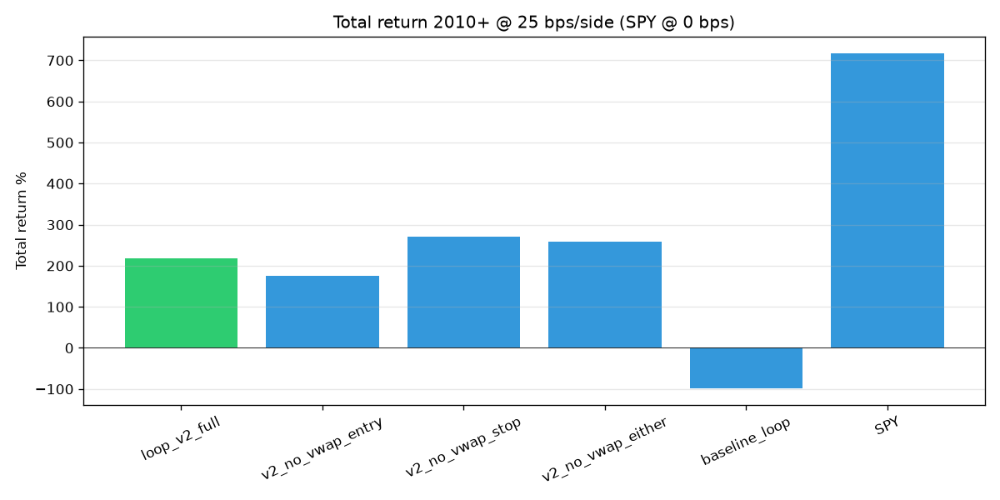
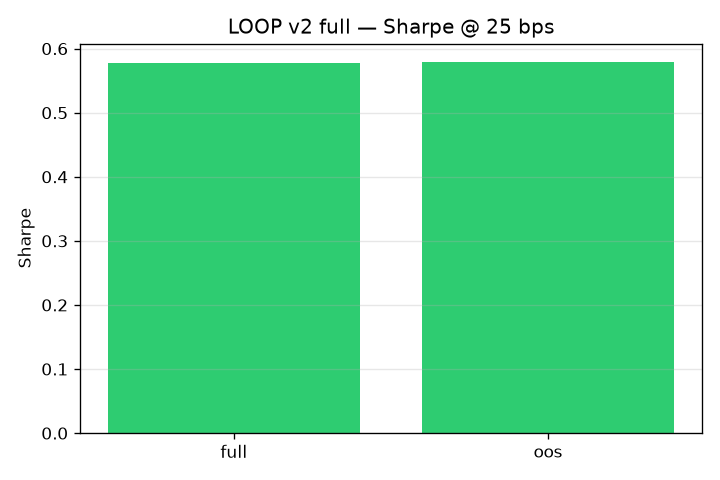

# LOOP v2 backtest report

**PR:** https://github.com/atanasvasilevjourney/ORBIS-EQUITY-/pull/128

**Evaluation end:** 2020-12-31 · **Deflated Sharpe trials:** 6

> Regenerate through latest data: `python -m pipeline.research.run_loop_v2_report --end YYYY-MM-DD` (runtime ~40+ min; downloads PIT union OHLCV once).
> This artifact used `--skip-baseline` (baseline LOOP run pending for full six-run table).

## Pass / fail (LOOP v2 full vs SPY @ 25 bps)

- **2010+:** FAIL
- **2019+ (OOS):** FAIL
- **Overall:** FAIL

_Criterion: v2 Sharpe > SPY Sharpe and |max DD| smaller than SPY in both windows at 25 bps/side._

## Results table (25 bps)

| Run | Period | CAGR | Total | Vol | Sharpe | D.Sharpe | MaxDD | Turnover | Avg names | % invested | VWAP fill % |
|-----|--------|------|-------|-----|--------|----------|-------|----------|-----------|------------|-------------|
| loop_v2_full | full | +7.9% | +130.0% | +13.2% | 0.64 | 0.61 | -22.6% | 95.3 | 25.4 | 93% | 98% |
| v2_no_vwap_entry | full | +6.8% | +105.9% | +13.2% | 0.56 | 0.53 | -23.1% | 94.7 | 25.7 | 93% | 0% |
| v2_no_vwap_stop | full | +9.3% | +164.7% | +13.9% | 0.71 | 0.67 | -26.1% | 77.1 | 26.4 | 97% | 98% |
| v2_no_vwap_either | full | +8.5% | +146.0% | +13.9% | 0.66 | 0.62 | -26.5% | 76.4 | 26.5 | 97% | 0% |
| SPY | full | +13.7% | +308.4% | +17.3% | 0.83 | 0.83 | -33.7% | 0.0 | 1.0 | 100% | 0% |
| loop_v2_full | oos | +13.9% | +29.7% | +15.0% | 0.94 | 0.86 | -14.9% | 522.5 | 25.4 | 93% | 98% |
| v2_no_vwap_entry | oos | +12.2% | +26.0% | +15.0% | 0.84 | 0.76 | -16.3% | 519.5 | 25.7 | 93% | 0% |
| v2_no_vwap_stop | oos | +13.1% | +28.0% | +15.5% | 0.87 | 0.79 | -18.4% | 422.7 | 26.4 | 97% | 98% |
| v2_no_vwap_either | oos | +12.0% | +25.5% | +15.5% | 0.81 | 0.72 | -18.4% | 418.7 | 26.5 | 97% | 0% |
| SPY | oos | +24.3% | +54.5% | +25.2% | 0.99 | 0.99 | -33.7% | 0.0 | 1.0 | 100% | 0% |

## Results table (10 bps)

| Run | Period | CAGR | Total | Sharpe | MaxDD |
| loop_v2_full | full | +9.3% | +166.2% | 0.75 | -21.3% |
| v2_no_vwap_entry | full | +8.2% | +137.9% | 0.67 | -21.9% |
| v2_no_vwap_stop | full | +10.3% | +193.9% | 0.78 | -25.4% |
| v2_no_vwap_either | full | +9.6% | +172.8% | 0.73 | -25.8% |
| loop_v2_full | oos | +15.4% | +33.2% | 1.03 | -13.9% |
| v2_no_vwap_entry | oos | +13.7% | +29.3% | 0.93 | -15.4% |
| v2_no_vwap_stop | oos | +14.2% | +30.5% | 0.94 | -18.0% |
| v2_no_vwap_either | oos | +13.1% | +27.9% | 0.87 | -18.0% |

## Charts

## Data caveats

- Universe: PIT S&P 500 (fja05680/sp500) ∪ Nasdaq-100 (Wikipedia change log; seed 2008-12-22).
- Dual share classes deduped (e.g. GOOGL over GOOG).
- NDX history before seed date may retain mild survivorship.
- GICS sector caps use live sector map where missing (Unknown bucket).
- Prices: yfinance auto_adjust=True.
