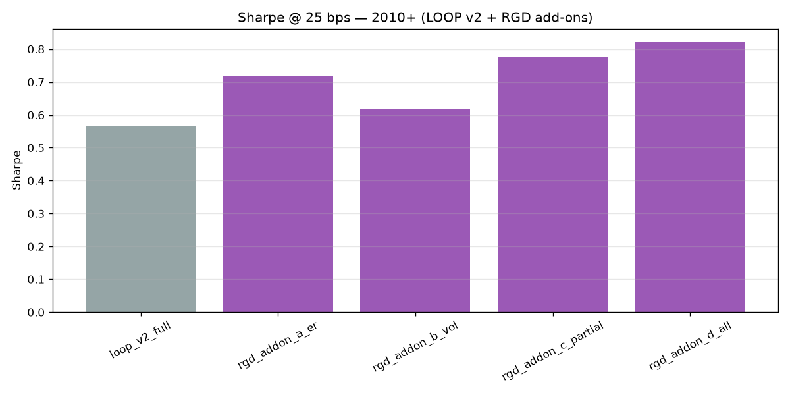

# LOOP v2 RGD add-ons report

**PR:** https://github.com/atanasvasilevjourney/ORBIS-EQUITY-/pull/129 (based on PR #128 branch)

**Evaluation end:** 2026-11-21 · **Deflated Sharpe trials:** 10

Pre-declared experiment on `loop_v2_full` (VWAP entry + stop). Add-ons: **A** ER≥0.30, **B** vol-switched 55/34 Donchian, **C** half at 2R + breakeven, **D** A+B+C.

## Pass / fail vs SPY @ 25 bps (Sharpe higher & |max DD| smaller, both windows)

- **loop_v2_full:** FAIL
- **rgd_addon_a_er:** FAIL
- **rgd_addon_b_vol:** FAIL
- **rgd_addon_c_partial:** FAIL
- **rgd_addon_d_all:** FAIL

## Per add-on — Sharpe vs LOOP v2 full @ 25 bps (both windows)

- **rgd_addon_a_er:** 2010+ ↑ · 2019+ ↑ → **improved both**
- **rgd_addon_b_vol:** 2010+ ↑ · 2019+ ↓ → **did not improve both**
- **rgd_addon_c_partial:** 2010+ ↑ · 2019+ ↑ → **improved both**
- **rgd_addon_d_all:** 2010+ ↑ · 2019+ ↑ → **improved both**

## Results @ 25 bps

| Variant | Period | CAGR | Total | Vol | Sharpe | D.Sharpe | MaxDD | Turnover | Avg names | % inv | Trades | Win% | Avg R |
|---------|--------|------|-------|-----|--------|----------|-------|----------|-----------|-------|--------|------|-------|
| SPY | full | +13.3% | +717.6% | +17.1% | 0.82 | 0.82 | -33.7% | 0.0 | 1.0 | 100% | 0 | 0% | 0.00R |
| loop_v2_full | full | +7.0% | +210.7% | +13.5% | 0.57 | 0.53 | -21.9% | 102.4 | 25.7 | 95% | 1173 | 2% | -1.57R |
| rgd_addon_a_er | full | +9.2% | +342.2% | +13.6% | 0.72 | 0.68 | -18.5% | 100.6 | 25.5 | 98% | 1067 | 3% | -1.21R |
| rgd_addon_b_vol | full | +7.9% | +261.4% | +13.9% | 0.62 | 0.58 | -17.4% | 105.1 | 25.6 | 98% | 1261 | 2% | -1.61R |
| rgd_addon_c_partial | full | +8.6% | +301.0% | +11.5% | 0.78 | 0.74 | -16.0% | 122.9 | 31.5 | 95% | 2301 | 37% | 0.36R |
| rgd_addon_d_all | full | +9.2% | +337.9% | +11.5% | 0.82 | 0.79 | -15.8% | 121.1 | 31.2 | 96% | 2280 | 36% | 0.36R |
| SPY | oos | +15.4% | +209.3% | +19.3% | 0.84 | 0.84 | -33.7% | 0.0 | 1.0 | 100% | 0 | 0% | 0.00R |
| loop_v2_full | oos | +7.3% | +74.0% | +14.4% | 0.56 | 0.51 | -17.9% | 219.4 | 25.7 | 95% | 1173 | 2% | -1.57R |
| rgd_addon_a_er | oos | +8.7% | +93.4% | +14.4% | 0.65 | 0.61 | -18.2% | 215.3 | 25.5 | 98% | 1067 | 3% | -1.21R |
| rgd_addon_b_vol | oos | +7.1% | +72.0% | +14.5% | 0.55 | 0.50 | -17.0% | 224.9 | 25.6 | 98% | 1261 | 2% | -1.61R |
| rgd_addon_c_partial | oos | +10.5% | +120.2% | +12.4% | 0.87 | 0.82 | -15.2% | 263.1 | 31.5 | 95% | 2301 | 37% | 0.36R |
| rgd_addon_d_all | oos | +10.0% | +111.5% | +12.2% | 0.84 | 0.79 | -14.7% | 259.4 | 31.2 | 96% | 2280 | 36% | 0.36R |

## Chart

## Baseline LOOP (PR 128) turnover note

_PR 128 `baseline_loop` shows **−98.8%** total (2010+) with **turnover 0** in the table. Turnover is **0 because** `run_baseline_loop` does not populate `turnover_days` in stats—`summarize_run` divides a missing counter by trading days. The catastrophic return is **not** a missing-turnover display bug: `run_donchian_vwap_portfolio` weekly TOP_N=8 strategy with ATR trail, run on the **expanded PIT merged universe** with `rotation_mode='weekly'`, fully replaces the book each rebalance; on a broad, survivorship-aware universe this legacy configuration loses most capital (compare ~+456% for `loop_v2_full` on the same data). No code change applied—v2 full is the intended baseline for this experiment._

- Universe: PIT S&P 500 ∪ Nasdaq-100 (merged_pit_universe).
- Add-ons A–D are pre-declared; no parameter tuning after results.
- Deflated Sharpe uses n_trials=10 (6 LOOP v2 harness + 4 add-on legs).
