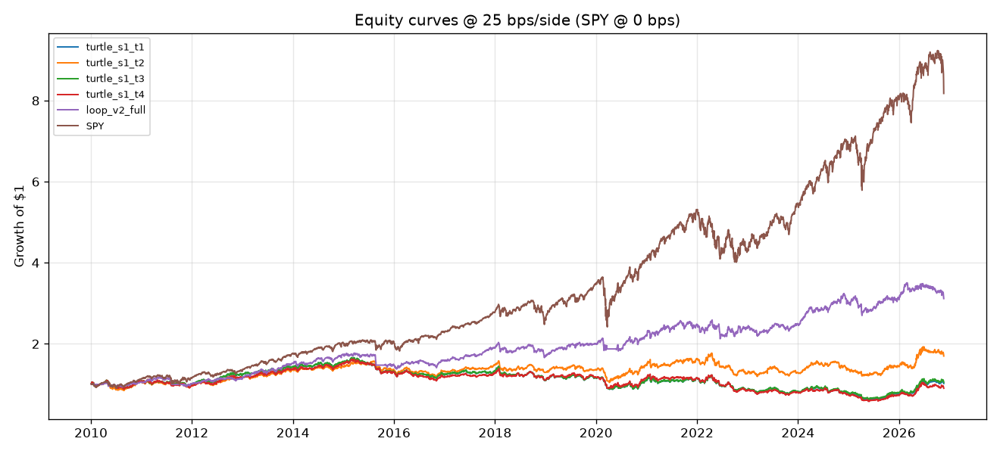
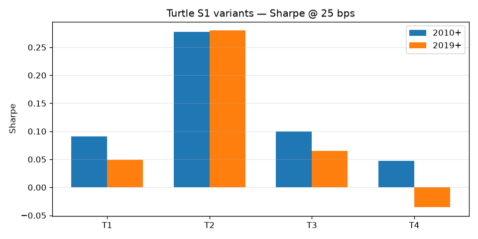

# Turtle System 1 Donchian backtest

**PR:** https://github.com/atanasvasilevjourney/ORBIS-EQUITY-/pull/131

**Evaluation end:** 2026-11-21 · **Deflated Sharpe trials:** 14

Pre-declared runs: **T1** baseline + skip rule, **T2** + 200d SMA, **T3** pyramiding, **T4** no skip,
**loop_v2_full** reference, **SPY** benchmark.

## Pass / fail vs SPY (@ 25 bps/side)

_Criterion: Sharpe > SPY Sharpe and smaller |max DD| in both 2010+ and 2019+ windows._

- **turtle_s1_t1:** 2010+ FAIL · 2019+ FAIL · **Overall FAIL**
- **turtle_s1_t2:** 2010+ FAIL · 2019+ FAIL · **Overall FAIL**
- **turtle_s1_t3:** 2010+ FAIL · 2019+ FAIL · **Overall FAIL**
- **turtle_s1_t4:** 2010+ FAIL · 2019+ FAIL · **Overall FAIL**

## Skip rule (T1 vs T4)

- Skip signals fired: **1029** (each followed a winning prior System 1 cycle on that symbol).
- T1 Sharpe (2010+ @ 25 bps): 0.09; T4: 0.05 → skip rule helped.

## Results table (25 bps)

| Run | Period | CAGR | Total | Vol | Sharpe | D.Sharpe | MaxDD | Turnover | Avg names | % inv | Trades | Win% | Avg days | Avg R | Payoff |
|-----|--------|------|-------|-----|--------|----------|-------|----------|-----------|-------|--------|------|----------|------|--------|
| SPY SPY | full | +13.3% | +717.6% | +17.1% | 0.82 | 0.82 | -33.7% | 0.0 | 1.0 | 100% | 0 | 0% | 0 | 0.00 | 0.00 |
| T1 turtle_s1_t1 | full | +0.1% | +2.0% | +16.6% | 0.09 | 0.06 | -63.0% | 82.5 | 9.7 | 99% | 1863 | 37% | 32 | 0.17 | 2.25 |
| T2 turtle_s1_t2 | full | +3.2% | +69.9% | +15.9% | 0.28 | 0.24 | -33.8% | 79.4 | 9.5 | 98% | 1765 | 39% | 33 | 0.22 | 2.21 |
| T3 turtle_s1_t3 | full | +0.3% | +4.8% | +16.7% | 0.10 | 0.06 | -62.1% | 82.5 | 9.7 | 99% | 1858 | 37% | 32 | 0.18 | 2.25 |
| T4 turtle_s1_t4 | full | -0.6% | -9.6% | +16.7% | 0.05 | 0.01 | -64.3% | 83.3 | 9.7 | 100% | 1878 | 37% | 32 | 0.17 | 2.25 |
| loop_v2_full loop_v2_full | full | +7.0% | +211.6% | +13.5% | 0.57 | 0.53 | -22.3% | 103.5 | 25.6 | 95% | 0 | 0% | 0 | 0.00 | 0.00 |
| SPY SPY | oos | +15.4% | +209.3% | +19.3% | 0.84 | 0.84 | -33.7% | 0.0 | 1.0 | 100% | 0 | 0% | 0 | 0.00 | 0.00 |
| T1 turtle_s1_t1 | oos | -0.9% | -7.0% | +19.3% | 0.05 | -0.00 | -50.7% | 176.7 | 9.7 | 99% | 922 | 35% | 30 | 0.10 | 2.20 |
| T2 turtle_s1_t2 | oos | +3.5% | +31.1% | +18.3% | 0.28 | 0.23 | -32.5% | 169.9 | 9.5 | 98% | 878 | 37% | 31 | 0.15 | 2.14 |
| T3 turtle_s1_t3 | oos | -0.6% | -4.8% | +19.4% | 0.07 | 0.01 | -49.5% | 176.6 | 9.7 | 99% | 916 | 35% | 30 | 0.11 | 2.20 |
| T4 turtle_s1_t4 | oos | -2.5% | -18.2% | +19.3% | -0.04 | -0.09 | -54.6% | 178.5 | 9.7 | 100% | 945 | 35% | 30 | 0.08 | 2.16 |
| loop_v2_full loop_v2_full | oos | +7.9% | +81.7% | +14.3% | 0.60 | 0.55 | -17.9% | 221.5 | 25.6 | 95% | 0 | 0% | 0 | 0.00 | 0.00 |

## Results table (10 bps)

| Run | Period | CAGR | Total | Vol | Sharpe | D.Sharpe | MaxDD | Turnover | Avg names | % inv | Trades | Win% | Avg days | Avg R | Payoff |
|-----|--------|------|-------|-----|--------|----------|-------|----------|-----------|-------|--------|------|----------|------|--------|
| T1 turtle_s1_t1 | full | +3.8% | +88.3% | +16.5% | 0.31 | 0.27 | -44.4% | 82.5 | 9.7 | 99% | 1863 | 37% | 32 | 0.17 | 2.25 |
| T2 turtle_s1_t2 | full | +6.8% | +203.7% | +15.8% | 0.50 | 0.46 | -29.4% | 79.4 | 9.5 | 98% | 1765 | 39% | 33 | 0.22 | 2.21 |
| T3 turtle_s1_t3 | full | +4.0% | +93.3% | +16.6% | 0.32 | 0.28 | -43.1% | 82.5 | 9.7 | 99% | 1858 | 37% | 32 | 0.18 | 2.25 |
| T4 turtle_s1_t4 | full | +3.0% | +65.9% | +16.6% | 0.26 | 0.23 | -46.9% | 83.3 | 9.7 | 100% | 1878 | 37% | 32 | 0.17 | 2.25 |
| loop_v2_full loop_v2_full | full | +8.5% | +293.1% | +13.4% | 0.67 | 0.64 | -21.2% | 103.5 | 25.6 | 95% | 0 | 0% | 0 | 0.00 | 0.00 |
| T1 turtle_s1_t1 | oos | +3.0% | +26.2% | +19.2% | 0.25 | 0.20 | -42.9% | 176.7 | 9.7 | 99% | 922 | 35% | 30 | 0.10 | 2.20 |
| T2 turtle_s1_t2 | oos | +7.4% | +75.5% | +18.2% | 0.48 | 0.43 | -29.4% | 169.9 | 9.5 | 98% | 878 | 37% | 31 | 0.15 | 2.14 |
| T3 turtle_s1_t3 | oos | +3.3% | +29.2% | +19.3% | 0.27 | 0.21 | -41.5% | 176.6 | 9.7 | 99% | 916 | 35% | 30 | 0.11 | 2.20 |
| T4 turtle_s1_t4 | oos | +1.3% | +10.6% | +19.2% | 0.16 | 0.11 | -46.3% | 178.5 | 9.7 | 100% | 945 | 35% | 30 | 0.08 | 2.16 |
| loop_v2_full loop_v2_full | oos | +9.4% | +103.4% | +14.3% | 0.70 | 0.65 | -17.6% | 221.5 | 25.6 | 95% | 0 | 0% | 0 | 0.00 | 0.00 |

## Charts

## Data caveats

- Universe: PIT S&P 500 ∪ Nasdaq-100; price ≥ $10; GOOG/GOOGL deduped.
- Daily bars; signals on close, fills at next open.
- Costs: 10 and 25 bps per side (commission + slippage).
- N = ATR(20) at entry; stop 2N; System 1 channel 20/10.
- Prices: yfinance auto_adjust=True.
- Reference: algomaya.com Turtle System 1 Donchian rules (research reproduction).
